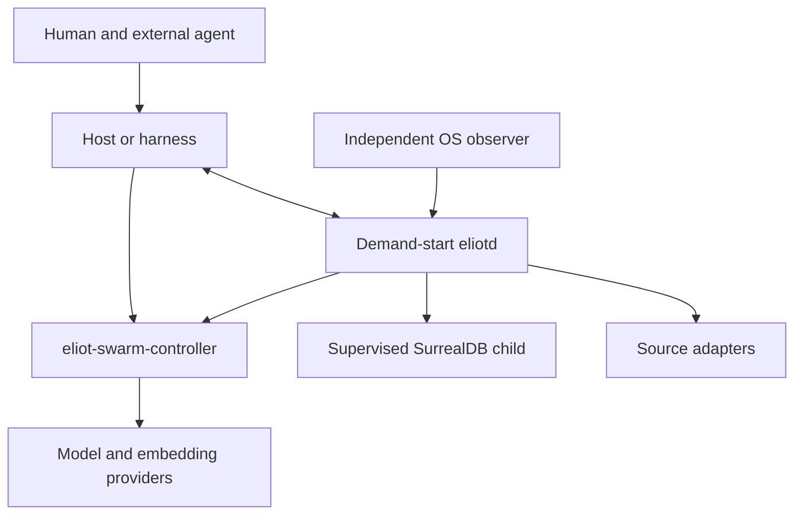

# Eliot Memory OS V3 — Architecture

**Revision:** 0.1, 2026-10-18. **Status:** draft architecture for discussion; V3 has not yet been implemented.

The owner's decision is that V1 and V2 become donors, and V3 will be designed and then written from scratch. Documentation is being changed first. The technical choices below are proposals for iterative refinement; they are not claims that every choice has been approved or implemented.

This draft also reflects reported owner decisions and personal context: `eliotd` is demand-start; SurrealDB runs as a child supervised by the daemon; `eliot-swarm-controller` is the primary router for model and embedding work and provides a unified task/adapter path; vectors are part of the full product, though vector service unavailability must degrade gracefully. These are inputs to the proposal, not independent verification of their implementation or approval of every detail. V3 does not require an internal swarm-controller.

This document defines purpose and preserved properties. [Implementation](IMPLEMENTATION.md) describes proposed mechanisms. The [consolidated audit](AUDIT.md) records evidence, alternatives, and reasons for changes. When a mechanism conflicts with an original requirement, revise the mechanism; the audit alone does not create new mandatory subsystems.

## 1. Purpose

Eliot turns accumulated experience from people and agents into a small, current, useful state for the next decision. It preserves observations, reconstructs context, detects contradictions, connects concepts to sources, warns against repeating mistakes, and changes subsequent behavior based on outcomes.

Smart Memory OS should support a complete loop: observation → preservation → understanding the current situation → action by an external agent → observable outcome → change to memory or working method → evaluation of usefulness on later tasks.

Quality is measured by which errors stop recurring, whether context becomes available in time, how much better work continues, and what resources it costs. The number of records, graph edges, model calls, modules, or reports is not the outcome.

Basis: [original Canonical Master, §§0–1](https://github.com/UnknownAlienHuman/eliot-memory-os/blob/b5c84d4e53292dbc8996917c63448d5ee96c4bc7/docs/architecture/ELIOT_Canonical_Master.md#L13-L153), [V2 A0.1](../architecture/A00-01-purpose-of-the-architecture.md).

## 2. Product boundary

| Responsibility | Owner |
|---|---|
| Current goal, task execution, launching agents and tools, swarm plan | External agent and its host/harness/controller; the human sets the goal and authority |
| Durable memory, provenance, revision, retrieval, context delivery, outcome memory | Eliot |
| Synthesis of hypotheses, concepts, procedures, and improvement proposals | Dreamer — a background model-work role within Eliot |
| Persistence, transactions, and indexes | One selected primary database through Eliot's internal storage module |
| Model and embedding routing | `eliot-swarm-controller` as the primary external router, called through a bounded job contract; Eliot does not reproduce the controller's task orchestration |
| Code, document, research, and notification sources | Adapters with declared capabilities and limits |
| Observation of process failure | An observer independent of the process being checked, preferably an OS-native supervisor and a small health probe |

Eliot keeps the links among a task, an attempt, the context received, a prediction, and the outcome. It does not duplicate the swarm scheduler, IDE, browser, general-purpose tool runtime, or build dispatcher. Deterministic memory operations remain usable without the controller. Dreamer and embedding work require a working configured controller route; the controller is an external execution dependency, not another swarm implemented inside Eliot.

If the host does not report actions or cannot accept proactive context, Eliot states that limitation plainly. It does not claim to observe or control work it cannot see.

A full integration passes the goal and task scope, resource-contact events, accepts a context offer before a dependent action, and returns available action/outcome observations. A passive host that only supports search is an allowed limited mode, but does not demonstrate proactive memory or closed-loop learning.

### 2.1. ModelJob boundary

Eliot submits model-dependent work through a typed, bounded `ModelJob` to the configured `eliot-swarm-controller` route; it does not call a provider directly from the canonical memory path. At minimum, a job identifies its job and task, operation (`dream`, `research`, or `embed`), authorized source handles and revisions, privacy/redaction limits, requested output contract, resource budget/deadline, and route constraints. The result returns the same job identity, selected route/provider, status (including unavailable, timeout, malformed, or partial), structured output or vector result, and provenance sufficient to link it to inputs. The controller handles provider/adapter routing; Eliot validates the result and source references before use or persistence.

Model or embedding absence records a degraded job and never blocks deterministic capture, exact/lexical retrieval, recovery, or other eligible work. A compatible API does not promise equal quality across models. Vector retrieval remains part of the full product behavior when its service is available; its temporary unavailability degrades retrieval to a truthful exact/lexical path, rather than making vector capability an optional product feature.

## 3. Simple physical form and real modularity

Proposed initial form: one demand-start `eliotd` service with internal modules. When started, the daemon supervises SurrealDB as a child process. CLI and service can be modes of one executable. Dreamer runs as background jobs of this service; remote model calls are routed as bounded jobs through the controller and do not require Eliot to run a permanently resident model daemon.

Logical boundaries are memory intake and storage; retrieval and context assembly; understanding and learning; background job execution; external adapters; and control and observability. These are code responsibilities, not a requirement to create six processes or six crates.

Internal details should be hidden behind ordinary modules and narrow functions. Add a crate or process when a separate heavy runtime, trust boundary, independent deployment, or demonstrated reduction in change cost requires it. The number of development subagents does not determine the number of product modules. Modularity should make mechanisms replaceable and their behavior locally understandable.

Restarting the service and recovering jobs is the proposed update path. Hot-swapping arbitrary modules, distributed coordination, and a custom plugin OS are not required for the first complete product. They may be added for a demonstrated need without changing the meaning of memory. The full V2 hot-replacement design is not a preservation requirement.

Failure of an optional capability is localized: healthy capture, reading, and independent work continue where safe. An external observer handles unrecoverable process failure. A Rust module boundary alone does not establish an isolation guarantee.

Basis: [V1 Production Architecture, §§0–3](https://github.com/UnknownAlienHuman/eliot-memory-os/blob/b5c84d4e53292dbc8996917c63448d5ee96c4bc7/docs/architecture/ELIOT_Rust_Governor_Production_Architecture_v1_0.md#L17-L347), [V2 I2.23: conditions for combining or extracting crates](../architecture/I02-23-capability-family-topology-and-crate-extraction-decisions.md).

## 4. Memory and knowledge

### 4.1. Preserve the observation first

An admissible input is preserved before semantic classification. Material that is not understood remains an observation with an unknown interpretation. Model unavailability, lack of a ready ontology, or incomplete learning does not block preservation or basic retrieval.

Access, permitted scope, and retention policy are checked before accepting data. A prohibition on storing a secret cannot be bypassed by a “write everything first” mode. A repeated delivery is identified by source-event identity; identical text from two distinct events does not make them the same event.

The response distinguishes a write to the primary database, a reliably preserved local deferred input, an unknown outcome, and a rejection. Do not report success until the corresponding durable preservation has occurred.

### 4.2. Preserve semantic distinctions in the data

A record makes it possible to establish its source and revision, subject and permitted use scope, acquisition time and known validity time, evidential status, relations, and whether it may influence later work.

Keep distinct:

- an observation and its interpretation;
- a claim, hypothesis, user decision, and procedure;
- corroboration and independent corroboration;
- factual validity, search availability, and permitted influence;
- an event in the past and new knowledge about that event;
- a structural relation, correlation, causal hypothesis, and intervention result.

Similarity, recall frequency, and model confidence do not increase truth. A human instruction sets a goal or policy within that person's authority; it does not turn a claim about the world into a verified fact.

Sources and material corrections are not silently overwritten. New evidence may refute, narrow, or replace a conclusion. If there are multiple independent supports, losing one requires reconsidering the justification rather than automatically deleting every conclusion. Derived text must not be left unchanged merely by removing an inconvenient citation.

### 4.3. Three distinct forms of forgetting

| Operation | Result |
|---|---|
| Reduce availability | Material appears less often in ordinary context, but remains available through permitted queries |
| Revise knowledge or revoke influence | The old conclusion no longer applies; history and rationale are retained to the permitted extent |
| Delete for privacy | The defined data scope is deleted, accounting for derived records, indexes, copies, and restore |

Compression must not destroy the sole source of an exception, failed attempt, or open commitment. Age and low use do not by themselves prove a memory wrong. After a backup is restored, revoked influence and deleted data must not return to use. Copies held by an external provider outside Eliot's control must be identified as such.

## 5. Context before the next decision

Ordinary retrieval is built without waiting for generative inference. Start with exact identifiers, active constraints, known failures, and lexical search; then use vectors and bounded relation expansion where useful and available. An unavailable embedding route does not block the base path, but vector retrieval remains a capability of the full product. Apply the permitted scope before candidate selection and again before revealing content.

The packet contains only what the current decision needs: goal and completion criterion, current state, constraints, relevant experience, project relations, contradictions, unknowns, the next useful step, and how to verify the result. Do not fill empty sections with template prose. Preserve exact values, exceptions, and refutations as complete semantic units.

Provide expansion handles for omitted material. A small retrieval record should explain inclusion, exclusion, staleness, cost, and coverage gaps. Re-fetching full content checks access again; an old handle is not permission.

Proactive memory activates on observable events: task start or continuation, opening a related resource, preparation for an action, an error, or a source change. An exact match for a known hazardous condition may restrict an action under an already established policy. Semantic similarity produces a warning, not an arbitrary prohibition.

## 6. Understanding, attention, and cognitive functions

Eliot maintains a reconstructible map: project purpose → subsystems → concepts and processes → files, symbols, and sources → verifiable effects. The names of the levels and the graph form may change. The map is grounded in actual revisions and marks unknown or stale areas.

Deterministic analysis provides structure, dependencies, changes, and exact locations. A model proposes purpose, boundaries, analogies, alternative explanations, and ways to distinguish them. Synthesis without support remains a hypothesis. A source change invalidates affected derived representations; missed events are detected by checking revisions.

Before a significant action, Eliot may record a verifiable prediction: what will change, where to observe the effect, and the conditions under which comparison is meaningful. Afterward, compare the outcome with that prediction. An unverifiable comparison remains unknown. Calibration is scoped to task family, project, and mechanism, not a universal “intelligence level” for the system.

Failure memory records the trigger condition, failed action, outcome, scope of applicability, and condition for reconsidering it. Successful repetition under changed conditions may narrow a restriction. Preserve history so that correcting a false warning also becomes experience.

In a supported integration, check applicable negative guidance before the dependent action. New evidence can challenge and revise a false restriction within actions already authorized; this does not bypass authority or privacy boundaries.

When people or agents disagree, Eliot preserves the distinct explanations, shared sources, and independent support; proposes a discriminating question or observation; and clearly bounds any provisional conclusion. This does not require an embedded swarm or model voting. Preserve partial results and coverage gaps from a large audit.

Attention means selecting what could change the next decision: a conflict, risk, missing support, overdue commitment, or new relevant evidence. A representation of the current task and events is enough; a separate “attention engine” is not required.

## 7. Self-learning with observable behavior change

V3 self-learning primarily changes external memory, procedures, context rules, and permitted routing recommendations. Training model weights is a separate capability and is not required for the product to work.

Each useful learning loop links an original attempt, a proposed concrete change, its scope, a subsequent comparable attempt, and its outcome. A change may be a new warning, better search order, different context expansion, a procedure with preconditions, or a check for an effect previously missed.

Local, reversible changes within already authorized policy may be applied automatically. Provide an active path into the next context or action rather than keeping candidates indefinitely. A successful attempt cannot grant new authority, change the ultimate goal, set global policy, authorize destructive actions, or publish to other users.

Broader reuse requires a transfer evaluation: known cases, held-out comparable cases, negative examples, and real subsequent work. Criteria and counter-metrics must not be silently changed along with the candidate. Detected harm leads to rollback or a narrower scope, not rewriting the evaluation result.

This evaluation may run automatically under pre-established policy; every classification or procedure does not need manual approval. Retrieval, context assembly, prediction, and verification methods may also improve as separately evaluated changes. A candidate cannot choose an easier evaluator or weaken its own acceptance criteria.

Distinguish: material found; delivered; available to the agent; an observed behavior change; an outcome obtained; and evidence that the change caused an improvement. The final step requires comparative data. Retrieval counts, word overlap, and model self-report do not prove usefulness.

When outcome signals are sparse, Eliot may still preserve a hypothesis and apply a limited reversible adaptation; it must not call that a proven general improvement. Learning from successes, failures, and false warnings are equally part of the product.

## 8. Dreamer and research

Dreamer is a replaceable executor of bounded tasks: consolidation, procedure extraction, revision, concept reconstruction, contradiction search, failure analysis, and proposing checks or improvements. Scheduled, manual, and event-triggered work use one job queue.

The configured model is selected according to quality, privacy, availability, and cost. The controller may provide routes to local models, OpenAI-compatible endpoints, or adapters for other APIs; Eliot only submits ModelJobs through that controller boundary. Each route must actually implement the required contract. Protocol compatibility does not guarantee equal quality. An unsupported response format produces an explicit error for that job while preserving the original observations.

The model receives an authorized set of sources and returns structured candidates. It does not receive SQL or primary-database credentials, cannot choose the record subject on its own, and cannot expand access scope. Before persistence, validate references, revisions, record ownership, and the permitted operation.

Research is a task type with a question, scope, sources, and result. No result in the examined sample is not evidence that none exists. Research providers may be external; their unavailability reduces declared coverage without blocking the rest of memory. A confirmatory conclusion is distinguished from an exploratory hypothesis.

Consider ideas from [Hy-Memory](https://github.com/Tencent-Hunyuan/Hy-Memory/tree/7b7fd217a8084fe0d5f9c196d9e4cb88dbba570a) at the mechanism level. Linking a writer to subsequent outcomes is useful; Hunyuan's specific weights, its entire memory hierarchy, and model-issued UPDATE/DELETE are not mandatory Eliot architecture.

## 9. Reliability, control, and trust boundaries

One storage module performs application-level changes to primary memory. A transaction links the record, any required follow-up job, and the operation result. This does not require the service to be globally single-threaded. Retries are allowed; operation identity and current revision control duplicate effects.

Background work is bounded in time, volume, parallelism, and cost. Completion checks the current claim and its unexpired lease; an expired or replaced worker cannot publish its result. A lost write response is not proof of failure and must not trigger a blind new action with a new identity.

Model failure preserves original material; index failure leaves exact or lexical reading available; database failure leaves an honest status and, if enabled, a bounded durable intake queue. A full queue rejects explicitly. A local spool does not become a second source of truth.

Independent supervision detects process termination or hangs. Internal diagnostics explain queues, errors, and lack of progress, but do not replace the external observer. Restart recovers unfinished jobs without declaring them complete.

Cognitive monitoring separately compares available workspace events with agent reports, detects missed updates and unresolved attention, and reduces claimed observability when signals are missing. It attempts to resynchronize and reports persistent gaps. It does not invent an unavailable signal. Notification receipt acknowledgment is not issue resolution.

People can see active work, delay reasons, material proposals, and limits of observation. They can pause or cancel work, configure model and budget, inspect provenance, correct memory, and revoke influence. Important notifications persist until delivered or explicitly expired; delivery failure is visible. The UI format may change.

External text and memory do not become higher-level instructions. Automated actions use host capabilities that were authorized in advance; a retrieved command string does not authorize its execution. There is no hidden fallback to broader access, a different region, or a more expensive model.

Task completion is tied to acceptance criteria and observable outcomes on a specific revision. A passing test, tool call, or Dreamer report does not by itself mean the whole task is complete. Incomplete, unverified, and unknown remain distinct.

## 10. Cost and evolution

Measure total cost: Eliot code, required external services, adapters, maintenance, builds, process memory, latency, tokens, model calls, and retries. Moving complexity into a controller or database does not make it disappear.

Add new methods to a working end-to-end path. For each change, state the desired outcome, the mechanism, and why the existing path does not provide it. Add a separate card, registry, process, or mandatory check only when it has an independent reason to exist.

Finish and agree on the documentation first; then write V3. Future product evaluation will use the [Implementation end-to-end scenarios](IMPLEMENTATION.md#12-end-to-end-scenarios-for-the-future-product). At this stage, these scenarios do not require creating test infrastructure or running V2. A smaller codebase should be a measured consequence of the system's shape, not an excuse to lose cognitive functions.
